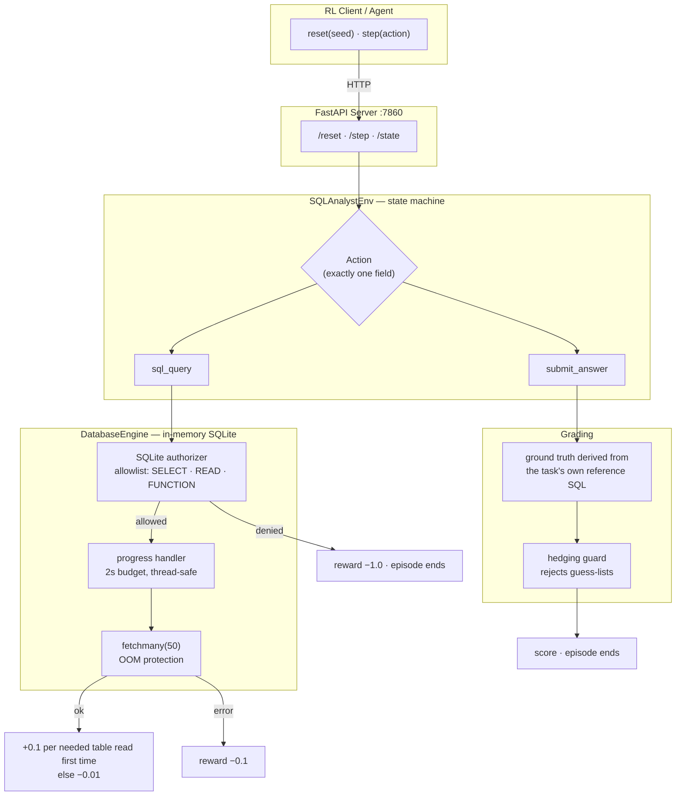

# SQLGym: a SQL-agent benchmark that attacks its own grader

> An OpenEnv environment where an LLM agent answers business questions by
> querying a SQLite database, built on the assumption that the grader is the
> part most likely to be wrong.

[](https://github.com/hitanshu04/openenv-sql-analyst/actions/workflows/ci.yml)
[](LICENSE)
[](https://www.python.org/downloads/)

**The problem.** Teams pick which AI agent to trust from benchmark scores. But a
benchmark is only as good as its grader: one that accepts a guess-list, rewards
stalling, or marks a correct sentence wrong ranks the wrong model first.

**What this is.** 14 SQL tasks behind the OpenEnv `reset` / `step` / `state` HTTP
API, on a generated database whose data contains realistic traps (inconsistently
typed countries, duplicate signups, refunds that change a ranking).

**What makes it different.**
- **A cheat suite attacks the grader and reward on every commit.** Scripted
  honest agents, cheaters and vandals check 288 rules in CI, so a cheater can
  never be graded correct, out-score an honest agent, or change the data. Its
  first run found 10 ways to fool the grader; for example, answering
  `"0 1 2 … 45"` scored higher than an honest agent.
- **Every answer is computed twice:** by the task's reference SQL, and by an
  independent Python oracle that uses no SQL.
- **Baselines are measured, not claimed:** 7 free models including Claude and
  Gemini, with every query recorded ([results](#baseline-scores)). On the
  dirty-data tasks, four models failed every run; only Claude Sonnet 5.5 solved
  them every time.

Started as a submission to the Meta PyTorch OpenEnv × Scaler hackathon
(selected top ~3% of 72,000+). The exact submitted version is preserved at tag
[`v1-hackathon`](https://github.com/hitanshu04/openenv-sql-analyst/tree/v1-hackathon).
Everything since is a post-hackathon audit and rebuild, documented in
[Engineering Notes](#engineering-notes).

<p align="center">
  
</p>

Run it in ten seconds, with no API key, model or network: `python demo.py`
([sample output](#see-it-run-no-api-key-needed)). The GIF is rendered from a real
run by [`docs/make_demo_gif.py`](docs/make_demo_gif.py), which refuses to write it
unless its text matches `demo.py`'s output line for line.

---

## How It Works



The design decision worth noting: **every guarantee is enforced by the layer
that actually owns it.** Read-only is enforced by SQLite's authorizer rather
than by inspecting query text; the timeout is enforced by SQLite's progress
handler rather than by an OS signal; ground truth is computed by the database
rather than written down by hand. Each of those replaced an earlier version
that could be circumvented — see [Engineering Notes](#engineering-notes).

---

## Environment Description and Motivation

This environment simulates a **mission-critical enterprise task**: an AI agent querying a production SQL database to extract business intelligence. In real-world enterprises, data analysts spend countless hours writing SQL queries to answer ad-hoc business questions from stakeholders. This environment provides a standardized benchmark to evaluate whether LLM agents can safely and accurately perform this task autonomously, measuring both **correctness** and **efficiency**.

### Why This Matters

- **Real-World Applicability**: Data analysis is one of the most common knowledge work tasks that LLMs are being deployed for
- **Safety-Critical**: Database access requires strict guardrails to prevent data corruption
- **Measurable Outcomes**: Business questions have definitive correct answers, enabling objective evaluation

### Production-Grade Security

The environment implements security safeguards that mirror real enterprise database access controls:

| Security Layer | Implementation | Purpose |
|----------------|----------------|---------|
| **Read-Only Authorizer** | SQLite `set_authorizer` allowlist — only `SELECT`, `READ`, `FUNCTION` permitted | Makes mutation structurally impossible, not merely discouraged |
| **OOM Protection** | `cursor.fetchmany(50)` instead of `fetchall()` | Prevents memory exhaustion on large result sets |
| **Query Timeout** | 2-second budget via `set_progress_handler` | Interrupts runaway queries; thread-safe and cross-platform |
| **Read-Only Sandbox** | In-memory SQLite (`:memory:` mode) | Isolated execution environment |

> **Why an authorizer instead of a keyword denylist?** A regex over query text
> cannot see what a statement actually *does*. It misses real mutations
> (`REPLACE`, `CREATE ... AS SELECT`, `ATTACH`) while rejecting innocent
> queries that merely mention a keyword inside a string literal. `PRAGMA
> query_only=ON` is also insufficient on its own — an agent can simply issue
> `PRAGMA query_only=OFF`. SQLite's authorizer is consulted for every operation
> in every statement, so it cannot be talked around with cleverly worded SQL.
> This closes a reward-hacking path where an agent rewrites the data to match
> its own answer.

---

## Action Space

The agent submits an `Action` object with **exactly one** of two fields:

| Field | Type | Description |
|-------|------|-------------|
| `sql_query` | `Optional[str]` | Execute a SQL query against the database |
| `submit_answer` | `Optional[str]` | Submit a final answer for grading |

**Mutual Exclusivity Enforced**: A Pydantic `@model_validator` ensures the agent provides exactly one of `sql_query` or `submit_answer`. Providing both or neither raises a `ValueError`.

```python
# Example Actions
action_query = Action(sql_query="SELECT COUNT(*) FROM users")
action_submit = Action(submit_answer="15")
```

---

## Observation Space

The agent receives an `Observation` object containing four fields:

| Field | Type | Description |
|-------|------|-------------|
| `schema_info` | `str` | Database schema information (tables, columns, types) |
| `current_question` | `str` | The business question the agent must answer |
| `last_query_result` | `str` | Result from the most recent SQL query (markdown table format) |
| `error_message` | `str` | Any error from the last action (empty string if none) |

---

## Reward Shaping

The environment implements precise partial reward signals to guide learning:

| Event | Reward | Episode Ends? |
|-------|--------|---------------|
| Successful query that reads a table the task needs, for the first time | `+0.1` per such table | No |
| Any other successful query (e.g. `SELECT 1`, a repeat, an unrelated table) | `-0.01` | No |
| SQLite syntax error | `-0.1` | No |
| Destructive action detected | `-1.0` | **Yes** |
| Step count >= 15 (infinite loop shield) | `-0.5` | **Yes** |
| Correct answer submitted | `+1.0` | **Yes** |
| Incorrect answer submitted | `0.0` | **Yes** |

**Why the query reward is bounded:** each table the task needs pays once, so
query reward is capped at `0.1 × (tables needed)`. The efficient agent collects
the whole cap, and every extra query lowers the total, so stalling or rewording
queries can never out-earn answering efficiently. Which tables a task needs is
derived from its reference SQL by the same SQLite authorizer that enforces
read-only access. The reward does hint which tables matter; the benchmark's
headline number is the final score, which depends only on correctness and steps.

**Final Score Calculation**: 
- If incorrect: `score = 0.01`, or `0.5` partial credit for a numeric answer within 10%
- If correct: `score = 0.7 + (1 - steps/15) * 0.28`, but only if the agent read
  every table the task needs before answering. A correct answer without that
  evidence still counts as correct, and scores a flat `0.7`, so a lucky guess can
  never outrank an agent that checked the data
- Score range: strictly between `0.01` and `0.99` (never exactly 0 or 1)
- Limit: the environment sees actions, not reasoning. An agent that already knows
  the answer can run an unrelated query on the right tables and look verified

---

## Task Descriptions

The environment includes **14 tasks**, each testing one SQL skill. Questions and
reference SQL live in [`environment/tasks.py`](environment/tasks.py).

| Task | Difficulty | SQL skill | Answer | The obvious wrong query gives |
|------|-----------|-----------|--------|-------------------------------|
| `easy_user_count` | easy | `COUNT` | `60` | |
| `medium_usa_revenue` | medium | `JOIN` + `SUM` + filter | `8245.30` | |
| `hard_top_spender` | hard | `JOIN`, `GROUP BY`, `ORDER BY`, `LIMIT` | `sofia` | |
| `medium_unsold_products` | medium | anti-join: `LEFT JOIN` … `IS NULL` | `4` | |
| `medium_multi_category_buyers` | medium | `HAVING COUNT(DISTINCT …)` | `37` | |
| `medium_best_month` | medium | date bucketing with `strftime` | `2024-04` | counting rows instead of summing revenue: `2024-09` |
| `hard_spend_rank` | hard | window function `RANK()` over an aggregate | `46` | |
| `hard_net_revenue_country` | hard | `LEFT JOIN` to refunds, gross minus refunds | `Canada` | ignoring refunds: `Spain` |
| `hard_top_buyer_tiebreak` | hard | explicit tie-break in `ORDER BY` | `bianca` | without the tie-break: one of the other two tied users |
| `hard_us_signups_dirty_country` | hard | dirty data: one country typed many ways | `64` | `WHERE country = 'USA'`: `24` |
| `hard_distinct_real_signups` | hard | dedupe on a normalised key + business exclusion | `150` | `COUNT(DISTINCT email)`: `177` |
| `hard_category_q2_q3_drop` | hard | conditional aggregation per quarter, then a ratio | `Kitchen` | largest absolute drop: `Furniture` |
| `hard_repeat_within_30_days` | hard | anchor on first purchase, `julianday` arithmetic | `25` | any two purchases 30 days apart: `45` |
| `medium_median_order_value` | medium | median with no `MEDIAN` function | `79.99` | `AVG`: `206.42` |

The last five were added after the first baselines showed the original nine
were solved by every frontier model (see [Baseline Scores](#baseline-scores)).
They target what analysts actually get wrong: data that must be explored and
cleaned before it can be filtered, business rules, and metrics whose naive
version is a different number.

**How the answers are kept honest.** The data is generated from a fixed seed by
[`data/generate.py`](data/generate.py) (60 users, 30 products, 444 purchases, 43
refunds, 185 signups). Rows are random, then a few are adjusted on purpose so each trap in
the last column exists, and the generator refuses data where an answer would
be ambiguous (e.g. a tie for top spender). Every answer is computed twice: by
the task's reference SQL, and by an independent Python oracle over the
generator's rows that uses no SQL. Tests require the two to agree, require the
committed `mock_data.sql` to be exactly what the generator writes, and run each
"obvious wrong query" to prove the trap still catches it.

### Grading System

All graders implement:
- **Derived ground truth**: Each task's answer is produced by executing its own
  `ground_truth_sql` against the same database the agent queries. No task stores
  a literal answer, so ground truth cannot silently drift from the data.
- **Type-agnostic normalization**: Whitespace trimming, lowercasing
- **Numeric answers are the one number written**: numbers are read with their
  sign, decimals, thousands separators, `$` and ordinal suffix, and the answer
  must contain exactly one distinct number. A sentence with one number
  (`"There are N users."`), `"$1,234.50"` and `"46th"` are read correctly; a
  list (`"0 1 2 …"`), a hedge (`"X or Y"`) or a different sign (`"-N"`) is not
- **Numeric tolerance**: Answers within 0.01 absolute tolerance are exact matches
- **Partial credit**: Numeric answers within 10% receive 0.5 score
- **Categorical answers** match as a whole word, and naming more than one
  candidate (e.g. every username) is rejected as a guess-list
- **Answers are values, never executed**: a submitted answer is always graded as a value. An earlier version executed any answer containing words like SELECT or FROM, so a correct sentence such as "The total revenue from USA customers is …" scored 0.01

---

## Setup and Usage Instructions

### Prerequisites

- Docker installed and running
- Python 3.10+ (for local development)
- (Optional) HuggingFace token for inference with HF-hosted models

### Quick Start with Docker

```bash
# Clone the repository
git clone https://github.com/hitanshu04/openenv-sql-analyst.git
cd openenv-sql-analyst

# Build the Docker image
docker build -t sqlgym .

# Run the container
docker run -p 7860:7860 sqlgym
```

The server will be available at `http://localhost:7860`

### API Endpoints

| Endpoint | Method | Description |
|----------|--------|-------------|
| `/` | GET | Health check (returns 200 OK) |
| `/reset` | POST | Reset environment, returns initial observation |
| `/step` | POST | Execute action, returns (observation, reward, done, info) |
| `/state` | GET | Get current internal state |

### Local Development (Without Docker)

```bash
# Create virtual environment
python -m venv venv
source venv/bin/activate  # On Windows: venv\Scripts\activate

# Install dependencies
pip install -r requirements.txt

# Run the server directly
python -m server.app

# Or run validation
chmod +x validate.sh
./validate.sh
```

### Running Inference

```bash
# Set environment variables
export API_KEY="your-api-key"
export API_BASE_URL="https://api.openai.com/v1"  # or LiteLLM proxy endpoint
export MODEL_NAME="gpt-4o-mini"

# Run inference
python inference.py
```

### Environment Variables

| Variable | Description | Default |
|----------|-------------|---------|
| `API_KEY` | API key for LLM provider (injected by hackathon) | **Required** |
| `API_BASE_URL` | OpenAI-compatible API endpoint (injected by hackathon) | **Required** |
| `MODEL_NAME` | Model identifier | `gpt-4o-mini` |

### See It Run (no API key needed)

```bash
python demo.py             # instant
python demo.py --replay    # paced, for screen recording
```

Real output, not an illustration — this is what the command prints. Colour is
emitted only when stdout is a terminal, so piping to a file (as here) yields
clean text and CI logs stay readable.

```text
====================================================================
1. A COMPLETE EPISODE  (task: hard_top_spender)
====================================================================

  Question: Who is the top spender (user with highest total purchase amount)? Provide the username
            of the user who spent the most money in total.
  Ground truth, derived from the task's own reference SQL: 'sofia'

  step 1  explore the users table            reward=+0.10  done=false
          -> | user_id | username | email | country | cr...
  step 2  typo: syntax error                 reward=-0.10  done=false
          -> SQLite Error: near "FRM": syntax error
  step 3  the actual analysis                reward=+0.10  done=false
          -> | username | spend | |---|---| | sofia | 82...
  step 4  submit the answer                  reward=+1.00  done=true

  step        1      2      3      4
  reward  +0.10  -0.10  +0.10  +1.00
              ▃      ▃      ▃      █
  cum.     0.10   0.00   0.10   1.10

  success   final_score=0.91   total_reward=+1.10

====================================================================
2. READ-ONLY ENFORCEMENT  (SQLite authorizer, not a regex)
====================================================================

  REFUSED          DELETE FROM users                              (classic mutation)
  REFUSED          REPLACE INTO users (user_id,username,email,c   (regex denylist misses it)
  REFUSED          CREATE TABLE evil AS SELECT * FROM users       (regex denylist misses it)
  REFUSED          ATTACH DATABASE ':memory:' AS side             (regex denylist misses it)
  REFUSED          PRAGMA query_only = OFF                        (defeats PRAGMA read-only)

  ALLOWED          a legitimate SELECT with 'drop table' in a string literal

====================================================================
3. THE GRADER CANNOT BE GAMED
====================================================================

  correct   score=0.94  sofia                                        (the exact answer)
  correct   score=0.94  The top spender is sofia.                    (a natural-language answer)
  REJECTED  score=0.01  aaron alice arjun bella bianca bob carlos    (every candidate at once)
  correct   score=0.94  $8,245.30                                    (a formatted number)
  REJECTED  score=0.01  8245.3 or 9069.83                            (two numbers at once)
  correct   score=0.70  sofia                                        (right, but never checked the data)

====================================================================
4. SEEDED RESET REPLAYS THE SAME EPISODE
====================================================================

  reset(seed=42)              -> task=hard_distinct_real_signups
  reset(seed=42)              -> task=hard_distinct_real_signups
  reset(seed=7)               -> task=medium_best_month
```

**Reading the reward trace.** The `step / reward / cum.` block is the shaping
signal the agent actually learns from. A syntax error costs `-0.10` and pulls
the cumulative line back down; the correct submission pays `+1.00`. Efficiency
is priced in separately at scoring time — the same correct answer is worth less
after more steps, which is why this episode scores `0.91` rather than the `0.94`
a two-step solution earns.

### Running the Test Suite

```bash
python tests/test_environment.py        # regression tests, stdlib unittest, no extra deps
python -m adversaries                   # cheat suite scoreboard (exits 1 if any rule fails)
```

Each test pins a property that was previously violated — ground truth derived
rather than declared, mutation structurally impossible, identical behaviour in
a worker thread, a grader that cannot be gamed by listing every candidate, a
seeded reset that replays exactly, and documented scoring actually reaching the
final score.

CI runs the tests and the cheat suite on Python 3.10/3.11/3.12, then builds the container and
asserts against the running image that a valid `SELECT` succeeds over HTTP,
that a mutation is refused, and that the process is not root.

### Validation Gates

Run `./validate.sh` before submission. All 4 checks must pass:

| Step | Check | Failure Condition |
|------|-------|-------------------|
| 1/4 | Prerequisites | `docker` or `openenv` CLI not found |
| 2/4 | Docker Build | `Dockerfile` missing or build fails |
| 3/4 | OpenEnv Spec | `openenv validate` fails (yaml/models mismatch) |
| 4/4 | Inference Logs | Missing `[START]`/`[STEP]`/`[END]` tags or invalid score |

---

## Baseline Scores

The tables between these markers are generated by `python -m baselines.summarize
--write-readme` from the recorded episodes; they are never edited by hand.

<!-- BASELINES:START -->
230 episodes: 7 models × 14 tasks × up to 3 repeats, run 2026-10-19 to 2026-10-19 with [`baselines/run.py`](baselines/run.py). Temperature 0, except Claude, whose CLI does not expose temperature. Raw episodes, including every query, are in [`baselines/results/`](baselines/results/).

| Model | Solved | Mean score | Avg steps when solved | Right but unchecked | Most common failure | Served via |
|---|---|---|---|---|---|---|
| `claude-sonnet-5-5` | 42/42 (100%) | 0.94 | 2.2 | 0 | – | Claude Code CLI on a claude.ai subscription, tools disabled |
| `gemini-3.5-flash` (partial: 10 of 42 episodes) | 10/10 (100%) | 0.93 | 2.8 | 0 | – | Google AI Studio free tier |
| `gemini-3.8-flash` (partial: 10 of 42 episodes) | 10/10 (100%) | 0.92 | 3.1 | 0 | – | Google AI Studio free tier |
| `gpt-oss-20b` | 36/42 (86%) | 0.81 | 2.1 | 0 | wrong answer (6) | Groq free tier |
| `claude-haiku-4-5` | 36/42 (86%) | 0.81 | 2.2 | 0 | wrong answer (6) | Claude Code CLI on a claude.ai subscription, tools disabled |
| `qwen3.8-27b` | 36/42 (86%) | 0.80 | 2.6 | 0 | wrong answer (6) | Groq free tier |
| `gpt-oss-120b` | 30/42 (71%) | 0.67 | 2.1 | 0 | wrong answer (12) | Groq free tier |

Per task (solved / runs):

| Task | `claude-haiku-4-5` | `claude-sonnet-5-5` | `gemini-3.5-flash` | `gemini-3.8-flash` | `gpt-oss-120b` | `gpt-oss-20b` | `qwen3.8-27b` |
|---|---|---|---|---|---|---|---|
| `easy_user_count` | 3/3 | 3/3 | 1/1 | 1/1 | 2/3 | 3/3 | 3/3 |
| `medium_usa_revenue` | 3/3 | 3/3 | 1/1 | 1/1 | 2/3 | 3/3 | 3/3 |
| `hard_top_spender` | 3/3 | 3/3 | 1/1 | 1/1 | 3/3 | 3/3 | 3/3 |
| `medium_unsold_products` | 3/3 | 3/3 | 1/1 | 1/1 | 2/3 | 3/3 | 3/3 |
| `medium_multi_category_buyers` | 3/3 | 3/3 | 1/1 | 1/1 | 3/3 | 3/3 | 3/3 |
| `medium_best_month` | 3/3 | 3/3 | 1/1 | 1/1 | 3/3 | 3/3 | 3/3 |
| `hard_spend_rank` | 3/3 | 3/3 | 1/1 | 1/1 | 0/3 | 3/3 | 3/3 |
| `hard_net_revenue_country` | 3/3 | 3/3 | 1/1 | 1/1 | 3/3 | 3/3 | 3/3 |
| `hard_top_buyer_tiebreak` | 3/3 | 3/3 | 1/1 | 1/1 | 3/3 | 3/3 | 3/3 |
| `hard_us_signups_dirty_country` | 0/3 | 3/3 | 1/1 | 1/1 | 0/3 | 0/3 | 0/3 |
| `hard_distinct_real_signups` | 0/3 | 3/3 | – | – | 0/3 | 0/3 | 0/3 |
| `hard_category_q2_q3_drop` | 3/3 | 3/3 | – | – | 3/3 | 3/3 | 3/3 |
| `hard_repeat_within_30_days` | 3/3 | 3/3 | – | – | 3/3 | 3/3 | 3/3 |
| `medium_median_order_value` | 3/3 | 3/3 | – | – | 3/3 | 3/3 | 3/3 |
<!-- BASELINES:END -->

**What the results show.** (Gemini rows are partial: its free tier allows about 20 requests a day per model.)

- **The first nine tasks were saturated, so five harder ones were added.** On
  the original nine, Claude Sonnet 5.5 and Haiku 4.5, gpt-oss-20b and Qwen3.8
  solved every episode, so those tasks could not rank strong models.
- **The harder tasks separate models below the top.** The two dirty-data tasks
  are the main point of separation. Asked for United States signups, models ran
  a single exact-match query (for example `WHERE country = 'United States'`) and
  answered `8` instead of `64`, without first looking at how the column is
  written. Asked for distinct people, they counted raw emails (`177`) instead of
  normalising case and spacing (`150`). Claude Haiku 4.5, Qwen3.8-27B,
  gpt-oss-120b and gpt-oss-20b failed both tasks in every run (0/3 each).
- **Three of the five new tasks do not separate models yet.** The quarterly
  drop, the 30-day repeat buyers and the median were solved by every model that
  reached them. Only the dirty-data tasks did.
- **Claude Sonnet 5.5 still solved everything** (42/42), and Gemini Flash solved
  every episode its free quota allowed, including the US-signups task. The benchmark separates the field below
  the top, but not yet at it. Tasks hard enough to separate the strongest models
  are future work.
- **Classic traps still catch smaller models.** `gpt-oss-120b` failed
  `hard_spend_rank` in all 3 runs: it wrote `RANK() OVER (…) … WHERE username =
  'karen'` in one query, so the filter ran before the ranking and it reported
  rank 1. In 3 other episodes it answered without running any query.
- **Harness failures are not scored as model failures, and model failures are
  not hidden as harness failures.** `gpt-oss-20b` sometimes emitted a call to a
  non-existent tool, which Groq rejects with HTTP 400. These are recorded as
  malformed replies, not skipped as outages.

Reproduce with `python -m baselines.run` (models and free-tier endpoints are
listed in [`baselines/providers.py`](baselines/providers.py); keys go in a
git-ignored `.env`). The runner resumes where it stopped, so free-tier daily
limits only delay a run, and an API failure is retried or left unrecorded,
never scored as a wrong answer.

### v1 (historical: 3 tasks, original 50-row dataset)

Measured with `inference.py` against the Groq API, `temperature=0.0`, one run
per task.

| Task | `gpt-oss-20b` | `gpt-oss-120b` |
|------|---------------|----------------|
| `easy_user_count` | ✅ 0.94 (2 steps) | ❌ 0.01 (1 step) |
| `medium_usa_revenue` | ✅ 0.94 (2 steps) | ✅ 0.94 (2 steps) |
| `hard_top_spender` | ✅ 0.94 (2 steps) | ✅ 0.94 (2 steps) |
| **Solved** | **3 / 3** | **2 / 3** |

The interesting result is the inversion: the larger model is the one that fails,
and it fails the *easiest* task. Given "How many users are registered?" it
answers `0` immediately without running a query, while the smaller model runs
`SELECT COUNT(*) FROM users` and answers correctly. Difficulty here is a measure
of SQL complexity, not of how likely a model is to guess instead of check —
which is exactly the kind of behaviour an evaluation environment exists to
expose.

> An earlier version of this README published an "expected score" table that had
> never been run. It was removed rather than left standing: a benchmark
> environment that reports unmeasured numbers undermines the thing it exists to
> provide.

### STDOUT Log Format

The inference script outputs logs in the exact required format:

```
[START] task=<task_id> env=sql_analyst model=<model_name>
[STEP]  step=<n> action=<action_type>=<value> reward=<r.rr> done=<bool> error=<msg>
[END]   success=<bool> steps=<n> score=<s.ss> rewards=<r1>,<r2>,...
```

**Example Output**:
```
[START] task=easy_user_count env=sql_analyst model=gpt-4o-mini
[STEP]  step=1 action=sql_query=SELECT COUNT(*) FROM users reward=0.10 done=false error=null
[STEP]  step=2 action=submit_answer=15 reward=1.00 done=true error=null
[END]   success=true steps=2 score=0.94 rewards=0.10,1.00
```

---

## Project Architecture

```
openenv-sql-analyst/
├── openenv.yaml          # OpenEnv specification (name, schemas, endpoints)
├── Dockerfile            # Container config (python:3.10-slim, port 7860)
├── requirements.txt      # Python dependencies
├── pyproject.toml        # Python project configuration
├── validate.sh           # Pre-submission validation (4 gates)
├── inference.py          # Baseline LLM agent implementation
├── demo.py               # Scripted end-to-end demo (no API key required)
├── data/
│   ├── generate.py       # Seeded data generator, Python answer oracles, data checks
│   └── mock_data.sql     # Generated database (5 tables, ~760 rows)
├── environment/
│   ├── __init__.py       # Package exports
│   ├── models.py         # Pydantic schemas (Action, Observation, Reward)
│   ├── db_engine.py      # SQLite engine with security safeguards
│   ├── tasks.py          # The 14 task definitions
│   ├── graders.py        # Deterministic grading system
│   └── env.py            # Main SQLAnalystEnv class (reset, step, state)
├── adversaries/          # Cheat suite: scripted honest agents and cheaters
├── server/
│   └── app.py            # FastAPI server (/reset, /step, /state endpoints)
├── tests/
│   ├── test_environment.py  # Regression tests (ground truth, data, read-only, threading, scoring)
│   └── test_cheat_suite.py  # Every scripted agent on every task must obey its rule
└── .github/workflows/
    └── ci.yml            # Tests + cheat suite on 3.10-3.12, container build and live smoke test
```

---

## Technical Specifications

| Specification | Value |
|---------------|-------|
| Python Version | 3.10 |
| Container Base | `python:3.10-slim` |
| Container Port | 7860 |
| vCPU Limit | 2 |
| Memory Limit | 8 GB |
| Max Runtime | 20 minutes |
| Max Steps per Episode | 15 |
| Query Timeout | 2 seconds |
| Max Fetch Rows | 50 |
| Database | SQLite (in-memory) |

---

## Database Schema

The database contains 5 tables, generated by `data/generate.py`:

### users
| Column | Type | Constraints |
|--------|------|-------------|
| user_id | INTEGER | PRIMARY KEY |
| username | TEXT | NOT NULL, UNIQUE |
| email | TEXT | NOT NULL |
| country | TEXT | NOT NULL |
| created_at | TEXT | NOT NULL |

### products
| Column | Type | Constraints |
|--------|------|-------------|
| product_id | INTEGER | PRIMARY KEY |
| product_name | TEXT | NOT NULL |
| category | TEXT | NOT NULL |
| price | REAL | NOT NULL |
| stock | INTEGER | NOT NULL |

### purchases
| Column | Type | Constraints |
|--------|------|-------------|
| purchase_id | INTEGER | PRIMARY KEY |
| user_id | INTEGER | NOT NULL, FOREIGN KEY |
| product_id | INTEGER | NOT NULL, FOREIGN KEY |
| quantity | INTEGER | NOT NULL |
| purchase_date | TEXT | NOT NULL |
| total_amount | REAL | NOT NULL |

### refunds
| Column | Type | Constraints |
|--------|------|-------------|
| refund_id | INTEGER | PRIMARY KEY |
| purchase_id | INTEGER | NOT NULL, UNIQUE, FOREIGN KEY |
| refund_amount | REAL | NOT NULL |
| refund_date | TEXT | NOT NULL |

A purchase is refunded at most once (`UNIQUE`), so joining refunds onto
purchases never double-counts a purchase.

### signups
| Column | Type | Constraints |
|--------|------|-------------|
| signup_id | INTEGER | PRIMARY KEY |
| email | TEXT | NOT NULL |
| country | TEXT | NOT NULL (free text, deliberately inconsistent) |
| channel | TEXT | NOT NULL |
| signup_date | TEXT | NOT NULL |

Signups are deliberately messy, as user-entered data is: the same country is
written several ways, some people signed up twice with differently cased or
spaced emails, and internal test accounts use the `sqlgym.test` domain.

---

## Engineering Notes

This environment was selected for Round 2 of the Meta PyTorch OpenEnv × Scaler
hackathon (top ~3%, ~2,000 of 72,000+ participants), judged on environment
design, reward shaping, novelty, and documentation.

Afterwards I audited it by *executing* it rather than reading it, and found
four defects that neither the validator nor a code review could have surfaced —
because `validate.sh` builds the Docker image but never runs it, and nothing in
the original repository ever sent an HTTP request to its own server. Everything
below was verified by reproduction, then pinned with a regression test.

### The timeout only worked in the main thread

Query timeouts used `signal.SIGALRM`. That works when the environment is driven
in-process, which is how `inference.py` and the validator exercise it. But
FastAPI schedules synchronous endpoints on a worker threadpool, and `signal`
can only be installed on the main thread — so **every query issued over HTTP
failed** with `signal only works in main thread of the main interpreter`, and
the agent received −0.1 for correct SQL.

Replaced with SQLite's progress handler, which is thread-safe and also removed
the Windows limitation the original code documented as unavoidable.

### Ground truth disagreed with the database

On the original dataset, `medium_usa_revenue` stored a hardcoded answer of
`2423.87`. Executing its own `ground_truth_sql` returned `2204.87`. A correct agent was graded wrong on every
episode of that task — and because the error was inside the 10% partial-credit
band, it failed quietly instead of loudly.

The fix was structural rather than arithmetic: tasks no longer store an answer
at all. `ground_truth` is derived at `reset()` by running the task's reference
SQL against the same database the agent queries, so the two cannot disagree.

### The mutation blocker was wrong in both directions

A regex denylist of six keywords let `REPLACE INTO`, `CREATE TABLE ... AS
SELECT` and `ATTACH DATABASE` through — `REPLACE` genuinely mutated the data,
which is a reward-hacking path: an agent can rewrite the rows so its answer
becomes correct. The same regex rejected legitimate queries such as
`SELECT ... WHERE username = 'drop table'`.

`PRAGMA query_only = ON` was not sufficient either, because an agent can simply
issue `PRAGMA query_only = OFF`. Enforcement moved to SQLite's authorizer as an
allowlist: SQLite consults it for every operation of every statement, so it
cannot be circumvented by rephrasing SQL. A denylist asks "what should I
block?" and is permanently one keyword behind; an allowlist fails closed.

### Documented partial credit never reached the score

The grader computed 0.5 for a near-miss numeric answer, then `env.py` discarded
it and returned the 0.01 floor — so a near-miss scored identically to a blank
submission, which is a degenerate learning signal. The grader's score is now
honoured.

### The grader could be gamed by hedging

Answer matching used unanchored substring containment, so submitting every
username scored 0.99 on the top-spender task. Matching is now whole-word, and
tasks with a categorical answer declare an `answer_domain_sql`; naming more
than one candidate from that domain is treated as a guess-list rather than an
answer. Verbose but singular answers still pass.

### Smaller corrections

- `reset()` now matches OpenEnv's `reset(seed=..., episode_id=...)` signature.
  Task selection previously used unseeded global `random`, so episodes could
  not be replayed.
- The step budget was off by one: `step_count` was incremented and the loop
  shield checked *before* the action ran, so the final action was silently
  discarded and a 15-step budget delivered 14.
- The container ran as root, installed an unused `gcc`, shipped `.git` into the
  image, and re-resolved dependencies on every start.

### Second audit: what the cheat suite and baselines found

Each item below was reproduced first, pinned with a failing test, and then fixed.

- **The grader marked correct sentences wrong.** Any answer containing SELECT,
  FROM, WHERE, JOIN, GROUP or ORDER was executed as SQL. So "The total revenue
  from USA customers is …" failed as broken SQL and scored 0.01. Answers are now
  always graded as values.
- **The step reward paid for stalling.** Every successful query earned +0.1, so
  13 × `SELECT 1` before a correct answer earned 2.3, against 1.1 for answering
  efficiently. The first fix, paying only for a *new* result, was itself
  farmable: renaming a column made every result new, again 2.3 against 1.1. The
  reward is now bounded. Each table the task needs pays once, and any other
  query costs 0.01.
- **Numeric answers could be gamed.** Categorical answers had a guess-list
  guard, but numbers had none, and whole-word matching treated `-` and `.` as
  word boundaries. As a result:
  - `"0 1 2 … 45"` scored 0.96 on the easy task, above an honest agent's 0.94;
  - `"X or Y"` was graded correct;
  - `"-15"` and `"15.5"` in a sentence were graded as 15.

  Numbers are now parsed with their sign, decimals and separators, and an answer
  must contain exactly one.
- **A lucky guess outranked checking the data.** A correct one-step answer scored
  0.96, above agents that queried first. A correct answer now earns the
  efficiency bonus only if the agent read every table the task needs.
- **A bug that only existed on Python 3.10.** Python before 3.11 reuses prepared
  statements even with `cached_statements=0`, so SQLite's authorizer never saw a
  repeated query. Two tasks then had no required tables, and every blind guess
  counted as verified. Local tests passed on 3.11; the container (3.10) exposed
  it over HTTP. The authorizer is now re-installed before each query, which
  forces a fresh, authorised prepare.
- **A data trap that did not trap.** The first tie-break task used a two-way tie.
  SQLite returns the last tied row, which happened to be the correct answer, so
  a query without the tie-break still passed. It is now a three-way tie in which
  the right answer is neither the first nor the last row.
- **The harness hid a model failure.** Groq rejects a generation that calls a
  tool nobody offered (HTTP 400). The first runner skipped those episodes as
  outages. They are now recorded as malformed replies.
- **Smaller:**
  - `openenv.yaml` still declared the old wrong answer, 2423.87.
  - `openenv-core` was imported but never provided `BaseEnv`, and its unpinned
    dependencies broke installs on some machines. It was removed, and `uv.lock`
    was regenerated.
  - Two README examples quoted scores that the formula does not produce.

---

## License

MIT License — see [LICENSE](LICENSE).

---

## Acknowledgments

Built for the **Meta x Scaler OpenEnv Hackathon** - advancing the frontier of LLM agent evaluation through standardized, production-grade reinforcement learning environments.
